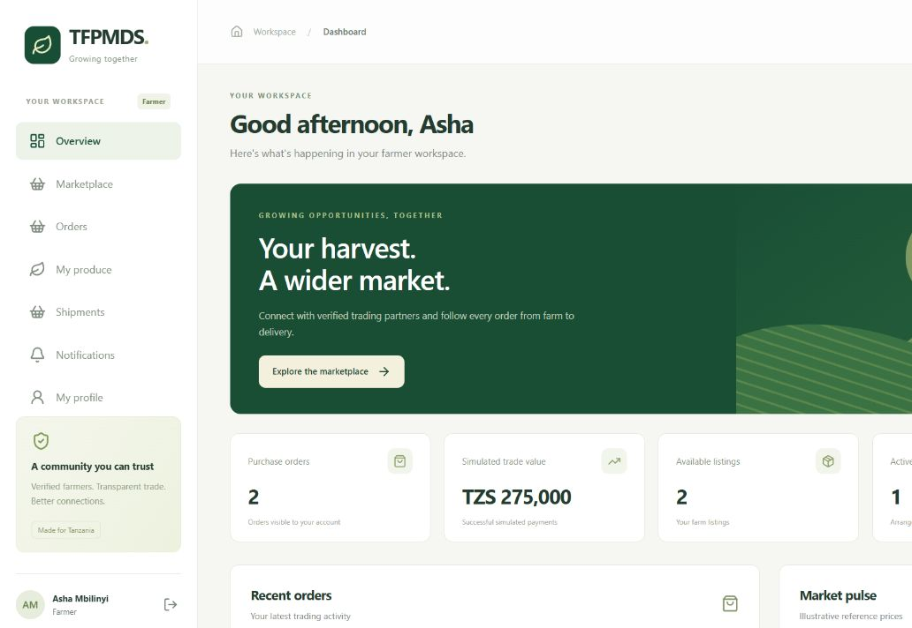
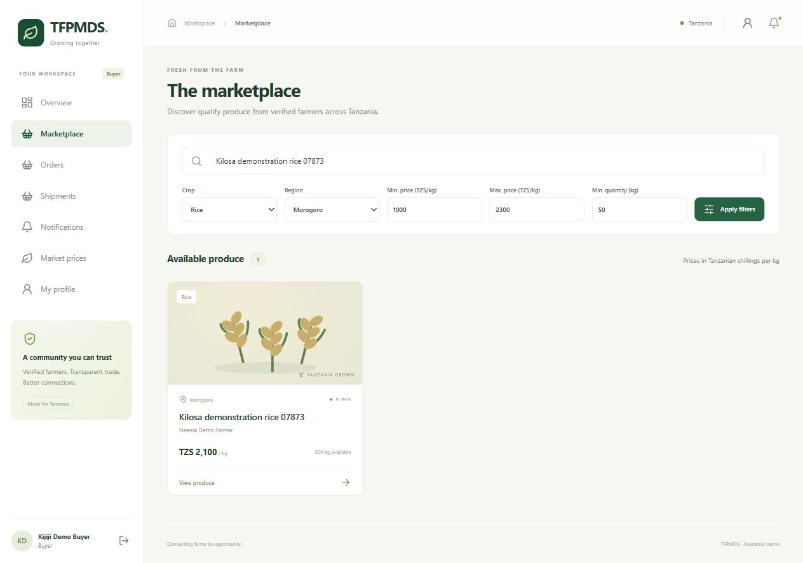
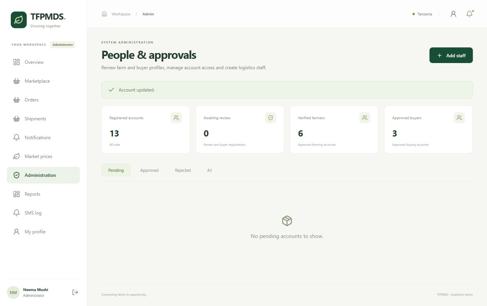
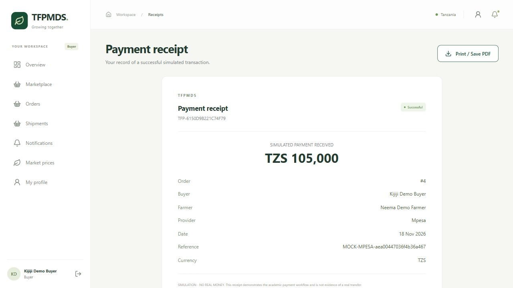
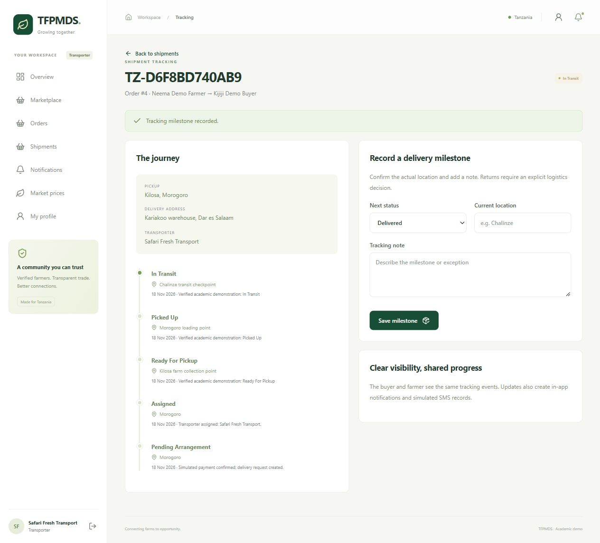
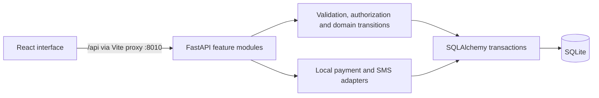
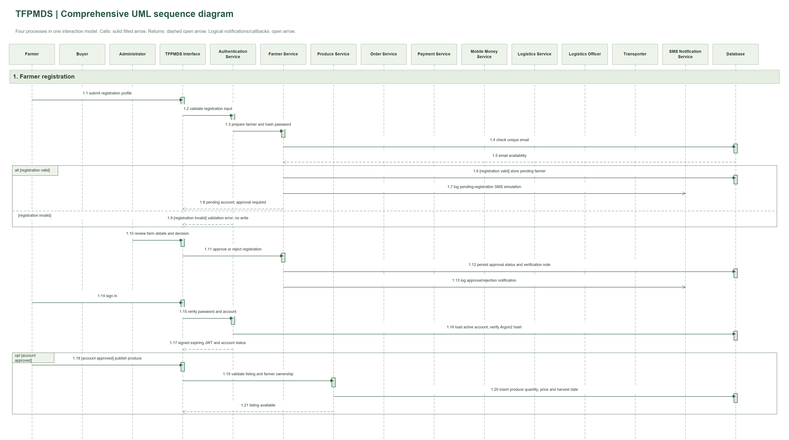
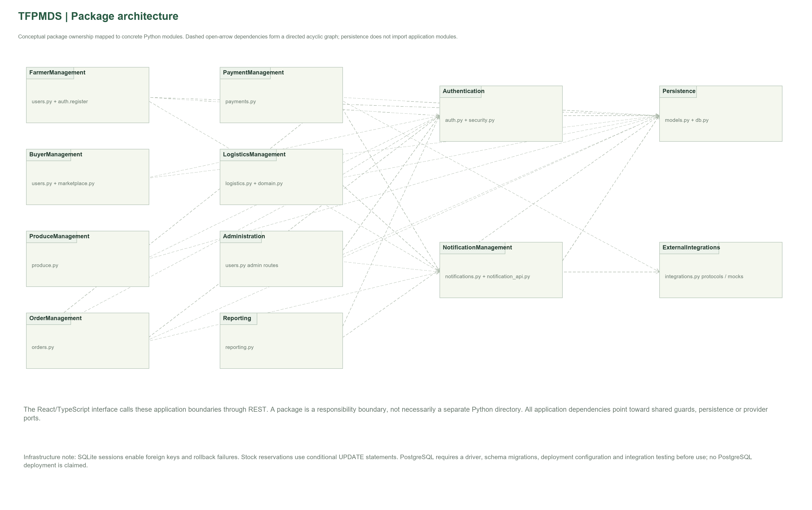

# TFPMDS · Growing together

**Tanzania Farmers' Produce Marketing and Distribution System**

A software engineering project connecting farmers, buyers and delivery teams through a shared produce marketplace, from account approval to order fulfilment.

[](#limitations)
[](#limitations)

[Overview](#overview) · [Features](#features-by-role) · [Screenshots](#screenshots) · [Architecture](#architecture) · [Quick start](#quick-start) · [Demo accounts](#demo-accounts) · [Testing](#testing) · [UML](#uml-diagrams) · [Documentation](#documentation) · [Acknowledgement](#developer-acknowledgement)

[](docs/screenshots/farmer-dashboard-full.jpg)

> **Academic demonstration:** mobile money and SMS are simulations. No real funds move, no PIN is requested and no SMS reaches a mobile network. Accounts, transactions and seed prices are illustrative.

## Overview

TFPMDS demonstrates four connected business processes: **farmer registration, produce ordering, payment processing and delivery tracking**. A responsive React interface serves five user roles, while a FastAPI backend enforces approvals, inventory rules and order/shipment transitions in SQLite.

### Problem statement

The assignment addresses fragmented coordination between farmers, produce buyers and transport providers: finding available produce, reviewing trading accounts, agreeing orders, recording payment outcomes and following delivery progress. TFPMDS brings those activities into one traceable workflow with role-based access, transaction records and notifications. It is a local academic prototype; no national deployment or measured real-world impact is claimed.

### Core workflow

1. A farmer or buyer registers; an administrator reviews the account before trading.
2. An approved farmer publishes produce; a buyer filters listings and submits an order.
3. The farmer accepts or rejects the order; an accepted order can proceed to simulated payment.
4. A successful mock payment creates a receipt and a shipment awaiting logistics assignment.
5. Logistics assigns a transporter, delivery milestones are recorded, and the buyer confirms completion after delivery.

In-app notifications and simulated SMS records accompany business events. Rejections, cancellations, failed payments and delivery exceptions have explicit handling.

## Features by role

| Role | Implemented capabilities |
| --- | --- |
| **Farmer** | Register and maintain a farm profile; manage produce listings, quantities and prices; accept or reject purchase orders; follow payments, deliveries and notifications. |
| **Buyer** | Register a business profile; search by crop, region, price and quantity; place orders; simulate mobile money outcomes; view and print receipts; track shipments and confirm delivery completion. |
| **Administrator** | Approve or reject trading accounts; manage account access and staff; maintain illustrative market prices; inspect orders, payments and simulated SMS; view sales reports and export CSV data. |
| **Logistics officer** | Review paid shipments; assign or reassign active approved transporters; record shipment progress and manage assignment, delivery and return exceptions. |
| **Transporter** | View assigned shipments; record permitted delivery milestones, locations and tracking notes. |

Public registration is limited to farmers and buyers. Pending accounts can log in and update profiles but require approval to trade. Staff accounts are seeded for the demonstration or created by an administrator.

## Screenshots

These are existing captures from the running application using synthetic demonstration data. Click an image to inspect it at full size.

| Produce marketplace | Account administration |
| --- | --- |
| [](docs/screenshots/marketplace.jpg) | [](docs/screenshots/administrator-approvals.jpg) |
| **Simulated payment receipt** | **Shipment tracking** |
| [](docs/screenshots/payment-receipt.jpg) | [](docs/screenshots/shipment-tracking.jpg) |

More views: [produce management](docs/screenshots/produce-management.jpg), [logistics assignment](docs/screenshots/logistics-assignment.jpg), [reports](docs/screenshots/reports-analytics.jpg), [simulated SMS log](docs/screenshots/sms-simulation-log.jpg), [completed order](docs/screenshots/completed-order.jpg) and [mobile marketplace](docs/screenshots/mobile-marketplace.jpg). The [browser journey evidence](docs/evidence/browser-journey.json) records the observed interactions.

## Technology stack

| Layer | Technologies |
| --- | --- |
| Frontend | React, TypeScript, Tailwind CSS, Vite, React Router, Lucide icons |
| API | Python, FastAPI, Pydantic, Uvicorn |
| Persistence | SQLite, SQLAlchemy ORM, database constraints and transactional stock reservations |
| Authentication | Expiring JWT bearer tokens, logout revocation, Argon2 password hashing, database-backed role and approval checks |
| Integrations | Local mock mobile money adapters and a persisted simulated SMS log |
| Verification | Pytest, HTTPX, Vitest, React Testing Library; typed Playwright journey harness |
| Engineering documentation | Editable draw.io XML, Markdown, A4 PDF and native Word documents |

Dependency specifications: [frontend manifest](frontend/package.json), [frontend lockfile](frontend/package-lock.json) and [backend lockfile](backend/requirements-lock.txt).

## Architecture



The backend is a modular application with feature routers for identity, produce, orders, payments, logistics, notifications and reports. Transactions coordinate stock reservations and state changes; idempotency keys and guarded updates protect order/payment processing. A successful terminal payment outcome creates one receipt and one shipment. Tracking is based on recorded milestones and locations.

The adapters run locally. Notification records are written in the business transaction; no external provider or background message queue is running. See [architecture and invariants](docs/ARCHITECTURE.md), the [API reference](docs/API_REFERENCE.md) and the [SQL schema](docs/database-schema.sql).

```text
backend/app/        REST modules, domain rules, schemas, ORM models and mock adapters
backend/tests/      API, authorization, concurrency and acceptance tests
frontend/src/       Role workspaces, reusable components, API and session handling
frontend/e2e/       Playwright journey source
demo/              Optional synthetic completed-journey database snapshot
docs/uml/          Eight editable UML models, PNG previews and catalogues
docs/screenshots/  Genuine application captures
docs/evidence/     JUnit results, browser checks and document verification
docs/submission/   Three editable Word report parts
scripts/           Verification, UML generation, reports and export tools
```

## Quick start

### Prerequisites

Use **Python 3.11+**, a recent **Node.js 22/24** installation with npm, and Git. The recorded development environment used Python **3.14.5**, Node.js **24.20.0** and Git **2.55**. The following commands use Windows PowerShell.

If you need a new checkout:

```powershell
git clone https://github.com/gloria-mbilinyi/TFPMDS.git
cd TFPMDS
```

### Install, seed and start the API

From the **TFPMDS repository root**:

```powershell
python -m venv .venv
.\.venv\Scripts\python.exe -m pip install -r backend\requirements-lock.txt
Push-Location frontend
npm ci --no-fund --no-audit
Pop-Location
Push-Location backend
..\.venv\Scripts\python.exe -m app.seed --demo
..\.venv\Scripts\python.exe -m uvicorn app.main:app --host 127.0.0.1 --port 8010
```

The explicit `--demo` seed is idempotent and preserves existing work. The normal database is `tfpmds.db` in the repository root.

### Start the frontend

Leave the API terminal running. Open a **second terminal at the repository root**:

```powershell
cd frontend
npm run dev
```

| Service | Local address |
| --- | --- |
| Application | [http://127.0.0.1:5173](http://127.0.0.1:5173) |
| Interactive API documentation | [http://127.0.0.1:8010/docs](http://127.0.0.1:8010/docs) |
| API health | [http://127.0.0.1:8010/api/health](http://127.0.0.1:8010/api/health) |

Vite proxies `/api` to **port 8010**. If port 5173 is occupied, use Vite's reported port or stop your own conflicting development server; leave unrelated processes running. Application assets are served locally after installation.

### Configuration and data

Optional overrides are documented in [`.env.example`](.env.example); place your local values in a root `.env`. Without `JWT_SECRET`, development generates an ignored `.development-secrets` file in the repository root. Keep it private and stable while sessions are active. Do not commit `.env`, secrets, the working database, `.venv` or `node_modules`.

An optional [synthetic database snapshot](demo/README.md) preserves the completed browser journey. It is not required for the seed-based installation; follow its instructions before selecting it, and preserve any database containing your own work.

## Demo accounts

After seeding, all five primary synthetic accounts use **`DemoPass123!`**:

| Role | Email |
| --- | --- |
| Farmer | `farmer@tfpmds.demo` |
| Buyer | `buyer@tfpmds.demo` |
| Administrator | `admin@tfpmds.demo` |
| Logistics officer | `logistics@tfpmds.demo` |
| Transporter | `transporter@tfpmds.demo` |

Follow the [14-step demonstration guide](docs/DEMO_GUIDE.md) for the complete registration-to-delivery journey and negative cases.

## Testing

The following are **recorded results from the implementation verification on 18 November 2026**. They are evidence snapshots, not a live CI badge.

| Check | Recorded result | Evidence |
| --- | --- | --- |
| Backend automated tests | **28 passed; 0 failures** | [Pytest JUnit](docs/evidence/backend-junit.xml) |
| Frontend automated tests | **5 passed; 0 failures** | [Vitest JUnit](docs/evidence/frontend-junit.xml) |
| Frontend production build | Passed | [Development log](docs/AGENT_DEVELOPMENT_LOG.md) |
| UML validation | Eight models passed XML, message, state and relationship checks | [UML guide](docs/uml/README.md) · [Editor verification](docs/evidence/uml-editor-verification.json) |
| Browser acceptance journey | **14 steps passed** in the supported in-app browser; CSV download and 390 px responsive/navigation checks passed | [Browser evidence](docs/evidence/browser-journey.json) |
| Functional requirement acceptance | **61 / 61 (100%)** in the frozen requirement catalogue | [Acceptance results](docs/evidence/acceptance-results.json) · [Traceability](docs/REQUIREMENTS_TRACEABILITY.md) |

Requirement acceptance coverage measures implemented and tested requirements. It is not statement/branch code coverage or production certification. Backend tests use temporary SQLite databases. The recorded run includes an upstream Starlette/HTTPX deprecation warning.

Run the automated checks from the repository root:

```powershell
.\scripts\verify.ps1
```

The [verification script](scripts/verify.ps1) runs backend tests, frontend tests, the production build, Playwright harness typechecking and UML validation. Its individual commands can also be run separately.

<details>
<summary>Optional Playwright browser execution</summary>

The [Playwright journey](frontend/e2e/full-journey.spec.ts) was typechecked, but a normal Chromium launch was blocked in the restricted development shell. The equivalent journey passed through the supported in-app browser. A separate passing Playwright execution is **not** claimed.

In a normal environment, start the seeded backend and frontend, then run from the repository root:

```powershell
cd frontend
npx playwright install chromium
npm run test:e2e
```

This journey creates synthetic demonstration records.

</details>

## UML diagrams

The repository contains **eight genuine editable draw.io XML models**, with movable shapes, connectors and labels. The sequence and corresponding communication model cover all four business processes, sharing **15 participants and 84 numbered messages**.

| Registration sequence excerpt | System package overview |
| --- | --- |
| [](docs/uml/previews/sequence-process-1.png) | [](docs/uml/package-overview.png) |

The left preview shows the registration process panel; use the links below for the complete interaction models. Click a preview to enlarge it.

| Model | Editable source | Full PNG preview |
| --- | --- | --- |
| 01 · Comprehensive sequence | [sequence.drawio](docs/uml/sequence.drawio) | [View](docs/uml/sequence.png) |
| 02 · Corresponding communication | [communication.drawio](docs/uml/communication.drawio) | [View](docs/uml/communication.png) |
| 03 · PurchaseOrder state machine | [purchase-order-state.drawio](docs/uml/purchase-order-state.drawio) | [View](docs/uml/purchase-order-state.png) |
| 04 · Shipment state machine | [shipment-state.drawio](docs/uml/shipment-state.drawio) | [View](docs/uml/shipment-state.png) |
| 05 · Overview package diagram | [package-overview.drawio](docs/uml/package-overview.drawio) | [View](docs/uml/package-overview.png) |
| 06 · Identity and produce package classes | [classes-identity-produce.drawio](docs/uml/classes-identity-produce.drawio) | [View](docs/uml/classes-identity-produce.png) |
| 07 · Orders and payments package classes | [classes-orders-payments.drawio](docs/uml/classes-orders-payments.drawio) | [View](docs/uml/classes-orders-payments.png) |
| 08 · Logistics and notifications package classes | [classes-logistics-notifications.drawio](docs/uml/classes-logistics-notifications.drawio) | [View](docs/uml/classes-logistics-notifications.png) |

**To edit:** download a `.drawio` source using GitHub's **Raw / Download raw file** control, then open [diagrams.net](https://app.diagrams.net/) and choose **File → Open from → Device**. The desktop draw.io application can also open each file independently. In a local checkout, use the files directly from `docs/uml/`.

Each interaction source retains its comprehensive primary model plus 16 editable A4 excerpt pages. The other six models each have one primary page. Existing PNGs were generated from the same source geometry by the bundled renderer; they are not draw.io Desktop exports. After manual edits, use diagrams.net's native export or update the generators. See the [UML guide and notation notes](docs/uml/README.md). The [export script](scripts/export_all_drawio.py) packages the sources and previews under the requested numbered delivery filenames.

## Documentation

| Resource | Contents |
| --- | --- |
| [Technical proposal](docs/TECHNICAL_PROPOSAL.md) · [Complete A4 PDF](docs/TFPMDS_Technical_Proposal.pdf) | Problem, requirements, design, implementation and verified academic report |
| [Word Part 1](docs/submission/TFPMDS_Technical_Proposal_Part_1.docx) · [Part 2](docs/submission/TFPMDS_Technical_Proposal_Part_2.docx) · [Part 3](docs/submission/TFPMDS_Technical_Proposal_Part_3.docx) | Three editable native Word documents with text, tables and diagram views |
| [Architecture](docs/ARCHITECTURE.md) | Boundaries, authorization, transactions, invariants and design decisions |
| [API reference](docs/API_REFERENCE.md) · [OpenAPI schema](docs/openapi.json) · [SQL schema](docs/database-schema.sql) | API contracts and persistence structure |
| [Requirements traceability](docs/REQUIREMENTS_TRACEABILITY.md) · [Frozen catalogue](docs/requirements.json) | Requirement-to-implementation, test and UML mappings |
| [Demo guide](docs/DEMO_GUIDE.md) · [Optional database snapshot](demo/README.md) | Repeatable demonstration and synthetic sample data |
| [Academic verification](docs/FINAL_ACADEMIC_VERIFICATION.md) · [Evidence](docs/evidence/) | Document coverage, rendering checks and recorded execution results |
| [Agent development log](docs/AGENT_DEVELOPMENT_LOG.md) · [Commit ledger](docs/LOCAL_COMMIT_HISTORY.md) | Human guidance, agent work, decisions, actual checks and local milestones |

The complete PDF has **103 A4 pages**. The Word parts preserve the original proposal's content boundaries (original PDF pages 1–10, 11–20 and 21–45); reflow produces **20, 37 and 47 Word pages**. Each was opened and saved in Microsoft Word with updated contents/page fields. The body uses 12-point Times New Roman and 1.5 spacing, with native tables. Diagram overviews and enlarged detail views preserve the complete models. The [academic verification report](docs/FINAL_ACADEMIC_VERIFICATION.md) explains source coverage and submission details.

<details>
<summary>Rebuild the academic documentation</summary>

After rerunning verification, execute from the repository root:

```powershell
.\.venv\Scripts\python.exe -m pip install -r docs\requirements-docs.txt
.\.venv\Scripts\python.exe scripts\generate_interaction_uml.py
.\.venv\Scripts\python.exe scripts\generate_structure_uml.py
.\.venv\Scripts\python.exe scripts\build_evidence_docs.py
.\.venv\Scripts\python.exe scripts\build_proposal.py
.\.venv\Scripts\python.exe scripts\build_word_parts.py
```

Word rendering requires Microsoft Word or LibreOffice. Update each part's table of contents after rebuilding. The [Word review helper](scripts/render_word_review.py) can rasterize actual Word PDF exports with the packaged renderer when LibreOffice is unavailable; it does not substitute a source-text layout. Regenerating interaction sources resets the publication excerpts; rebuilding the proposal restores them.

</details>

## Limitations

- **Deployment:** a local academic prototype, with no official Ministry endorsement or production deployment.
- **Integrations:** no real mobile money, SMS, live market-price feed, GPS tracking or identity-document verification. Location updates are manually recorded; prices are illustrative.
- **Production services:** refunds, password recovery, rate limiting, production monitoring, offline synchronization and a PostgreSQL deployment are outside the implemented scope.
- **Units:** produce quantities use whole kilograms, farm area uses whole acres and amounts use integer Tanzanian shillings (TZS).
- **Returns and reporting:** returned goods are not automatically restocked or refunded. Gross simulated sales include returned orders until a refund workflow is implemented.

## Developer acknowledgement

**Gloria Beneth Mbilinyi** · [@gloria-mbilinyi](https://github.com/gloria-mbilinyi)

Dar es Salaam Institute of Technology (DIT) · Bachelor of Engineering in Computer Engineering.

Developed as a software engineering academic project with disclosed **Codex assistance** in implementation, testing, UML modelling and documentation under the project owner's direction. The [development log](docs/AGENT_DEVELOPMENT_LOG.md) records human guidance, agent contributions, verification results and limitations.

### Repository history and manual publication

The official repository is [gloria-mbilinyi/TFPMDS](https://github.com/gloria-mbilinyi/TFPMDS). The original **26-commit implementation baseline is already published on `main`**, ending at `ddc2e8a`. Subsequent documentation milestones extend that baseline through additional commits, preserving existing history.

<details>
<summary>Commands for the owner to publish local commits</summary>

From the repository root, inspect the branch and remote, then push using your own GitHub authentication:

```powershell
git status
git remote -v
git log --oneline --reverse
git fetch origin
git push -u origin main
```

The expected origin is `https://github.com/gloria-mbilinyi/TFPMDS.git`. Authenticate as **gloria-mbilinyi**. If needed, run `git credential-manager github login --username gloria-mbilinyi --device` in your terminal. If a push is rejected because the remote changed, inspect and merge that work before retrying; preserve the existing milestone history.

</details>
