# TFPMDS

## Tanzania Farmers' Produce Marketing and Distribution System

**Technical proposal and implementation report**

Computer Engineering software engineering project. Academic prototype, version 1.0.0. Prepared under the direction of the project owner, GitHub account `gloria-mbilinyi`, with disclosed Codex assistance. 18 November 2026.

Institution: Dar es Salaam Institute of Technology (DIT)

Programme: Bachelor of Engineering in Computer Engineering

Student: Gloria Beneth Mbilinyi

Registration number: [To be completed]

Course or module name: [To be completed]

Lecturer or supervisor: [To be completed]

Submission date: [To be completed]

Official repository: https://github.com/gloria-mbilinyi/TFPMDS

This document reports implemented and verified local behavior. It is not an official Ministry publication or a claim of a deployed government service. Payments, SMS, users and reference prices in the demonstration are synthetic.

---

## 1. Executive summary

TFPMDS connects farmers, produce buyers and agricultural logistics personnel through a shared marketplace and an auditable order-to-delivery workflow. The assignment scenario identifies limited market access, weak price visibility, delayed payments, difficult buyer-farmer connections and fragmented shipment information as the problems to address. The implemented prototype responds with approved trading accounts, searchable listings, stock reservations, farmer order decisions, simulated mobile money, receipts and shipment tracking.

The application uses React, TypeScript and Tailwind CSS for the interface; FastAPI, Pydantic and SQLAlchemy for the backend; and SQLite for local persistence. Argon2 password hashing, expiring JWTs, server-side logout revocation and database-backed role checks protect account actions. Mobile money and SMS are explicit mock adapters, so the demonstration requires neither payment credentials nor a real mobile network.

All 61 functional bullet requirements in the brief are represented in the acceptance catalogue and supported by implementation and named passing tests. The verified automated result is 28 backend tests and five frontend tests passed, with no failures. The production frontend build and eight editable UML models also passed their recorded checks. A complete 14-step journey with fresh farmer and buyer registrations was verified through the supported in-app browser, including CSV download and a mobile viewport check. Standard Playwright browser launch was blocked by the restricted shell; the supplied harness was typechecked and is not reported as a separate passing run.

The 100% figure measures functional acceptance in this local simulated scope. It is not a statement of complete code coverage, production readiness, formal verification or real provider integration. Local Git milestones preserve the genuine development process. Codex created the initial 26 commits locally without pushing. The project owner subsequently completed the human-authorized push to `gloria-mbilinyi/TFPMDS`; the published baseline is `ddc2e8aacc48ece0dfad27b19e5f26317f56cd58`. GitHub's read-only commit listing confirmed those 26 commits during this correction review. These academic corrections remain local for the owner to push. No collaborator was added and repository ownership was preserved.

## 2. Introduction

Agricultural marketing involves several related decisions: what produce is available, which trading partners can be trusted, what quantity can be supplied, when an order is accepted, whether payment has been confirmed and how goods reach a buyer. A useful software engineering prototype must connect these decisions rather than present disconnected registration and listing forms.

TFPMDS treats an order as the link between farmer, buyer, payment and shipment. The platform reserves produce when an approved buyer submits an order, requires the responsible farmer's decision, permits payment only after acceptance and creates logistics work only after successful simulated confirmation. Both trading parties can inspect the resulting history.

The project is an academic response to a supplied scenario. No field survey, Ministry integration or live Tanzanian market-price collection was conducted. The geographic examples support a realistic demonstration without implying that the system has already been adopted by real farmers or public institutions.

## 3. Problem statement

The supplied brief describes seven related problems. Small-scale farmers have limited access to buyers; reference prices are difficult to compare; payment confirmation may be delayed; buyers struggle to find suitable suppliers; agricultural transport is poorly coordinated; shipment visibility is limited; and transaction monitoring is weak.

These problems create an information continuity requirement. A listing should identify an approved seller and available quantity. An order should preserve its agreed price and quantity even if the listing later changes. A payment should refer to that order, and a shipment should refer to a confirmed payment outcome. Administrators need a consistent view of those records.

The prototype cannot establish that it improves farmers' incomes or reduces delivery times in the real world. Those effects would require operational data and user research. Its demonstrable contribution is a technically coherent workflow that records and exposes the information needed to support such improvements.

## 4. Project objectives

1. Provide farmer and buyer registration, editable profiles and explicit administrator approval before trading.
2. Publish agricultural produce with validated stock, price and harvest information, and support useful marketplace filters.
3. Maintain stock consistency through atomic reservations, authorized farmer decisions and controlled cancellation.
4. Demonstrate mobile money initiation, failure, cancellation, retry, duplicate prevention and receipts without moving money.
5. Coordinate transporter assignment and enforce a shipment lifecycle with shared tracking and explicit exceptions.
6. Provide in-app notifications, simulated SMS history, transaction monitoring, reference prices and basic sales analytics.
7. Make the implementation reviewable through tests, genuine editable UML, traceability, source documentation and honest Git/agent evidence.

## 5. Scope and limitations

The implemented scope includes all eight functional modules in the brief and the 18 required prototype screens. Staff accounts, realistic illustrative seed data, automated API/unit checks, editable UML, screenshots and an academic PDF support demonstration and assessment. The local application does not depend on paid infrastructure.

The scope is a single local deployment using SQLite. Quantities use whole kilograms, farm area uses whole acres and currency uses integer TZS. A purchase order can contain multiple distinct produce lines, but all lines must belong to one farmer. Buyers place separate orders for different farmers. This rule makes responsibility, payment and shipment ownership unambiguous.

No real mobile money, SMS, GPS, identity-document verification, external price feed, password recovery, refund automation, offline synchronization, production monitoring or PostgreSQL deployment is claimed. Administrator verification is a review of supplied profile information, not a government identity check. Reference prices are illustrative. Returned goods are not automatically restocked because their condition must be reconciled. Successful simulated sales remain in gross reports until a future refund workflow exists.

Production use would require additional engineering: HTTPS and deployment controls, rate limiting, account recovery, migrations, provider security reviews, durable external-delivery workers, operational monitoring, backup restoration tests, accessibility assessment and load testing.

## 6. Stakeholder and actor analysis

| Actor | Responsibility | Principal permission boundary |
| --- | --- | --- |
| Farmer | Register, maintain farm information, publish produce, decide orders, track shipments | Approved account; owns listing and is the order's responsible farmer |
| Buyer | Register, search, order, simulate payment, view receipts, track and confirm delivery | Approved account; owns the purchase order/payment |
| Administrator | Review registrations, activate accounts, create staff, inspect transactions and reports, manage reference prices | Active approved administrator role |
| Logistics Officer | Review paid delivery requests, assign transporters, update arrangements, authorize returns | Active approved logistics or administrator role |
| Transporter | Inspect assigned work and record pickup, transit and delivery milestones | Active approved transporter assigned to that shipment |
| Mobile Money Service | Supply a mock reference and a simulated completion entry point | Internal mock callback secret or buyer-owned simulation route |
| SMS Notification Service | Produce simulated message references and recorded notification history | Mock adapter called from authorized business workflows |

The Ministry is the sponsoring stakeholder in the assignment scenario, while farmers and buyers are the primary business users. Staff are operational stakeholders. The project owner is responsible for academic submission, reviewing the agent's work and deciding when to push the preserved local commits.

## 7. Functional requirements

The acceptance catalogue preserves the brief's functional bullet requirements as 61 numbered items. It was created before implementation and was not reduced to make the coverage figure easier to meet. Requirements are grouped as follows.

| Module | IDs | Count | Implemented behavior |
| --- | --- | --- | --- |
| Farmer registration | A01-A08 | 8 | Registration, login/logout, profiles, farm details, crops, verification and status notifications |
| Produce management | B01-B08 | 8 | Listing creation/edit/deactivation, quantities, prices, dates, availability and validation |
| Buyer management | C01-C07 | 7 | Registration/approval/login/profile, search, filters and farmer listings |
| Ordering | D01-D07 | 7 | Creation/validation, notifications, decisions, lifecycle/history and reservations |
| Payments | E01-E09 | 9 | Three providers, initiation/status/records/receipts, failure/cancellation and duplicates |
| Logistics | F01-F08 | 8 | Role dashboards, paid requests, assignment, progress, tracking and confirmation |
| Administration | G01-G08 | 8 | Account review/management, transactions, sales, reference prices and analytics |
| Notifications | H01-H06 | 6 | Simulated SMS, in-app messages and order/payment/delivery history |

Each requirement has a concrete implementation mapping, passing test reference and UML mapping in `REQUIREMENTS_TRACEABILITY.md`. Appendix A reproduces that matrix. A single integration test can support several requirements when it exercises and asserts those connected behaviors; provider-specific requirements point to their exact parameterized tests.

## 8. Non-functional requirements

| Quality concern | Implemented measure | Verification and remaining limit |
| --- | --- | --- |
| Security | Argon2, signed expiring JWTs, revoked token IDs, role/ownership guards, validated inputs, private response projections | Authorization and token tests pass; no production penetration test is claimed |
| Data integrity | Foreign keys, unique keys, numeric/state constraints, conditional updates and rollback | Competing buyers, callback races and partial-order rollback tested |
| Usability | Consistent role navigation, labelled forms, loading/error states, responsive layouts and explicit simulation language | Full browser journey, CSV download and 390 px navigation check passed |
| Maintainability | Feature modules, shared state vocabulary, reusable frontend components, provider protocols and generated references | Typed build, tests, source/diagram checks; no strict framework-independent use-case layer is claimed |
| Portability | SQLAlchemy models, common relational types, BIGINT totals and environment-selected database URL | PostgreSQL DDL types compile; PostgreSQL runtime/migration testing remains future work |
| Auditability | Order snapshots, payment references, receipts, tracking events, notifications, Git milestones and agent log | Demonstration and evidence files retained |
| Availability and performance | Local failure feedback and bounded order size/search result limits | Local operation verified; no uptime commitment, load benchmark or offline mode |

These are academic quality measures rather than unmeasured production service-level guarantees. The prototype deliberately distinguishes current evidence from future deployment targets.

## 9. System architecture

The frontend renders role-aware screens and calls REST routes under `/api`. Pydantic validates request bodies. Feature modules apply current account approval, role and ownership checks, coordinate state changes and call SQLAlchemy persistence. The database dependency commits a successful request and rolls back on failure. Public response projections avoid exposing password hashes and unnecessary profile fields.

Separation of concerns follows clean architecture principles through a shared domain vocabulary, feature/application modules, explicit persistence models, validation schemas, response projections and provider ports. The implementation is a compact modular layered application: some feature functions serve both as FastAPI endpoint adapters and reusable application operations. It is not presented as a strict framework-independent hexagonal architecture. This choice keeps a student-scale prototype understandable while preserving clear replacement points for providers and persistence.

`MobileMoneyProvider` and `SmsProvider` define integration contracts. The mock implementations return unique local references. No real provider call occurs. Notifications are stored in the same transaction as the related business action. A real asynchronous delivery implementation would require an outbox and worker; logical asynchronous arrows in the UML do not imply such infrastructure already exists.

The persistence layer does not import API feature modules. Authentication and notifications depend on shared persistence/ports, while ordering, payments and logistics reuse authorization and transition helpers. The package overview and dependency JSON are checked for cycles. The React application remains a separate client, with the Vite development proxy forwarding API calls to port 8010.

## 10. UML sequence diagram

`uml/sequence.drawio` is one comprehensive, genuine editable mxGraph document. It covers farmer registration, ordering, payment and delivery using 15 participants and 84 numbered messages. It includes activation bars, synchronous calls, return messages, logical asynchronous notifications, alt/opt/loop fragments and guarded alternatives.

The interaction begins with validation and pending registration. Invalid input is not persisted. Administrator review and approved-account guards precede trading. Ordering reserves stock atomically and branches on farmer acceptance/rejection. Payment branches on success, failure or cancellation; only success creates a receipt and shipment. Logistics assignment precedes transporter progress, shared tracking and buyer completion.

The four figures below represent the four processes of that single canonical diagram. The A4 publication divides each process into consecutive message excerpts with larger labels and repeated active lifeline headers. These are views of the same interaction, not separate sequence models. Every numbered message, guard and logical notification is retained. The canonical draw.io source also retains the complete combined-fragment geometry and all 15 participants. Inactive lifelines are omitted only from individual publication excerpts.

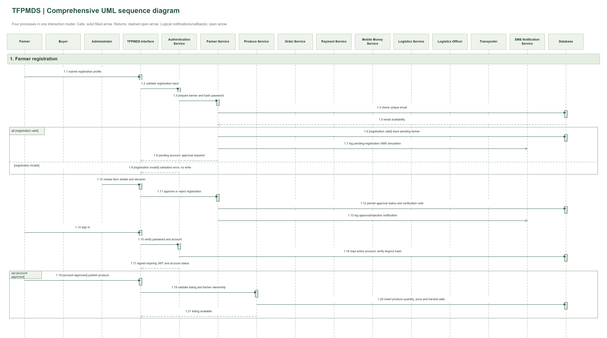

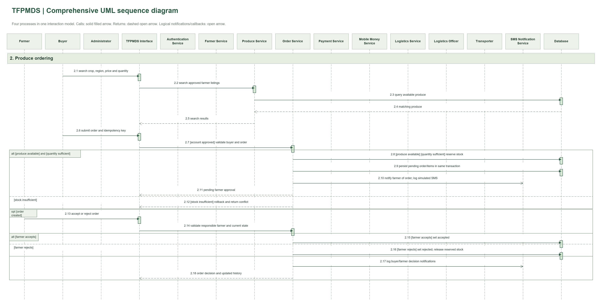

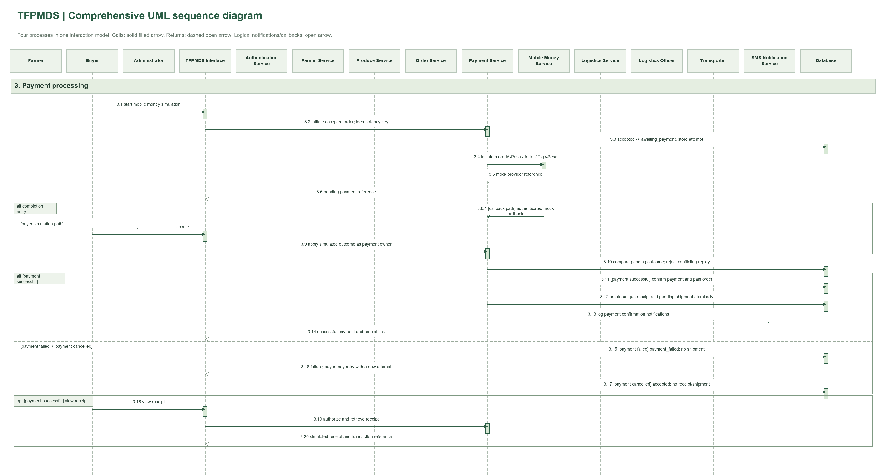

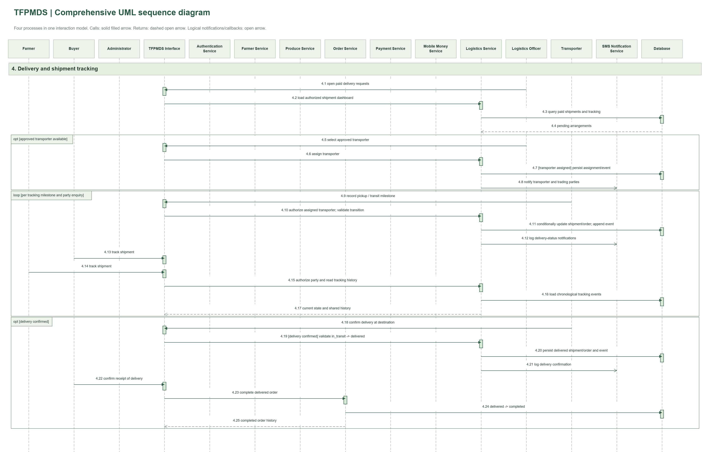

## 11. UML communication diagram

`uml/communication.drawio` is one communication model corresponding to the sequence. A shared source catalogue drives both diagrams, preserving object identities, message numbers, conditions and the nested callback number `3.6.1`. Four collaboration views repeat the same objects by process for readability. Links carry numbered interactions and the adjacent message register retains complete descriptions.

The communication view emphasizes which collaborators exchange information rather than introducing a second time-ordered workflow. The generated validator confirms that all 84 messages and all 15 participants are present in both models. The A4 publication separates collaboration excerpts and their complete numbered message registers to keep the labels readable. As with the sequence, the mock SMS/callback notation describes logical events; actual local notification recording occurs within the request transaction.

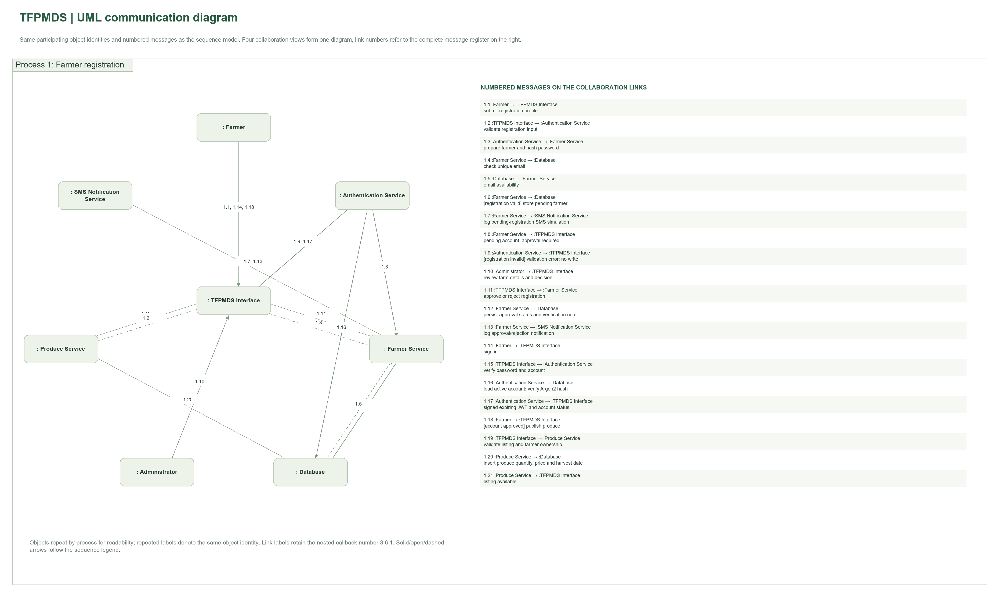

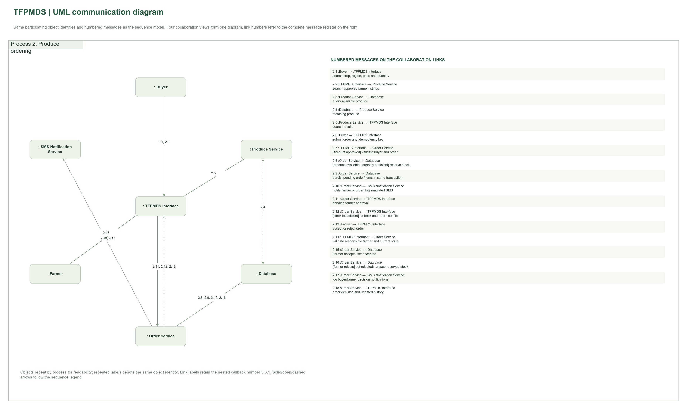

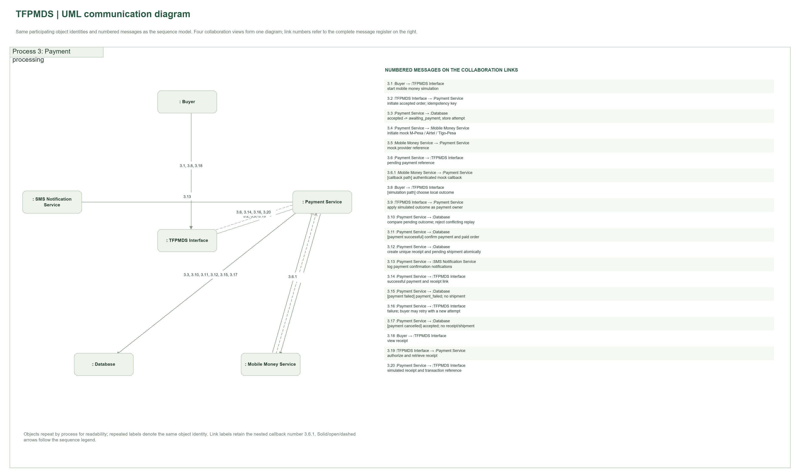

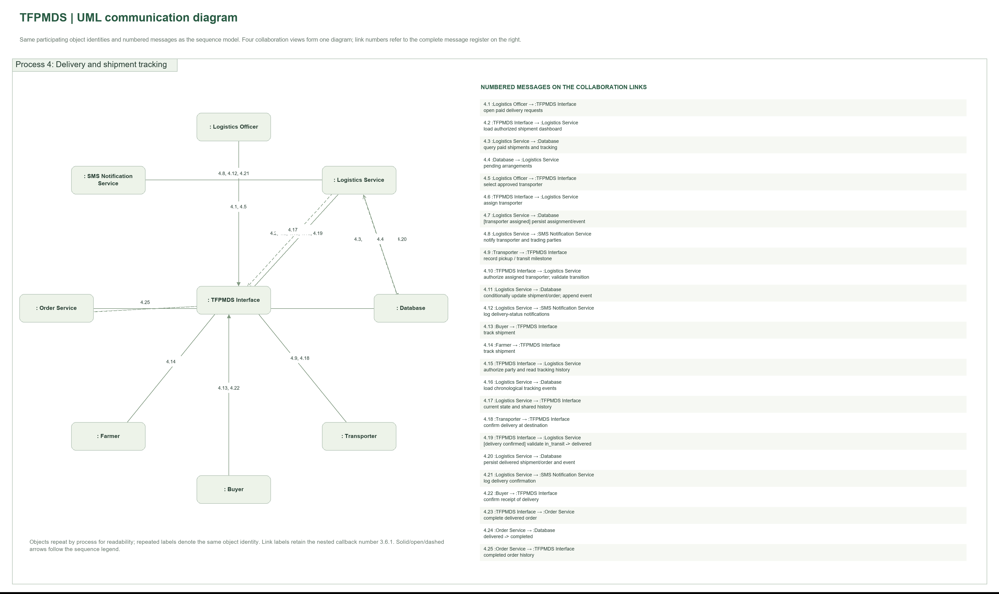

## 12. Behavioral state machines

The PurchaseOrder state machine separates validation from persistent business state. Created is a transient validation step. A stored order begins PendingFarmerApproval only after every reservation succeeds. The normal path continues through Accepted, AwaitingPayment, Paid, ProcessingDelivery, InTransit, Delivered and Completed.

Rejection and ordinary cancellation release reservations once. Failure leaves stock reserved so a buyer can retry or explicitly cancel. Cancelling a pending payment attempt restores Accepted; it does not silently cancel the order. Paid orders cannot use ordinary cancellation. A completed order remains stable unless logistics explicitly starts the documented return exception. Returned goods do not trigger an assumed refund or restock.

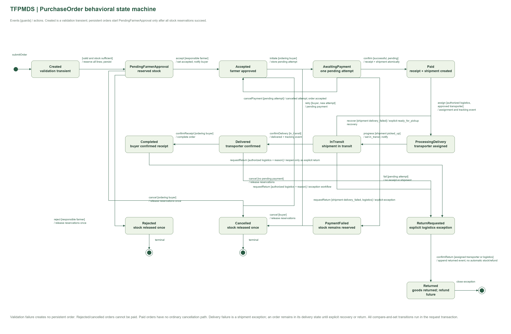

The Shipment machine uses the exact graph in `backend/app/domain.py`. Assignment can occur from pending arrangement, awaiting transporter or assignment failure, and controlled reassignment is allowed while Assigned. Pickup and transit must precede delivery. Failure and recovery paths are explicit. Delivered has no ordinary backward edge; only authorized logistics personnel can request a return with a required reason. Returned is terminal.

The transition register attached to the diagram gives events, guards and actions for every numbered edge. Initial/final pseudostates and all implementation states are checked programmatically. The tests also exercise normal delivery, forbidden reversal and the explicit return path.

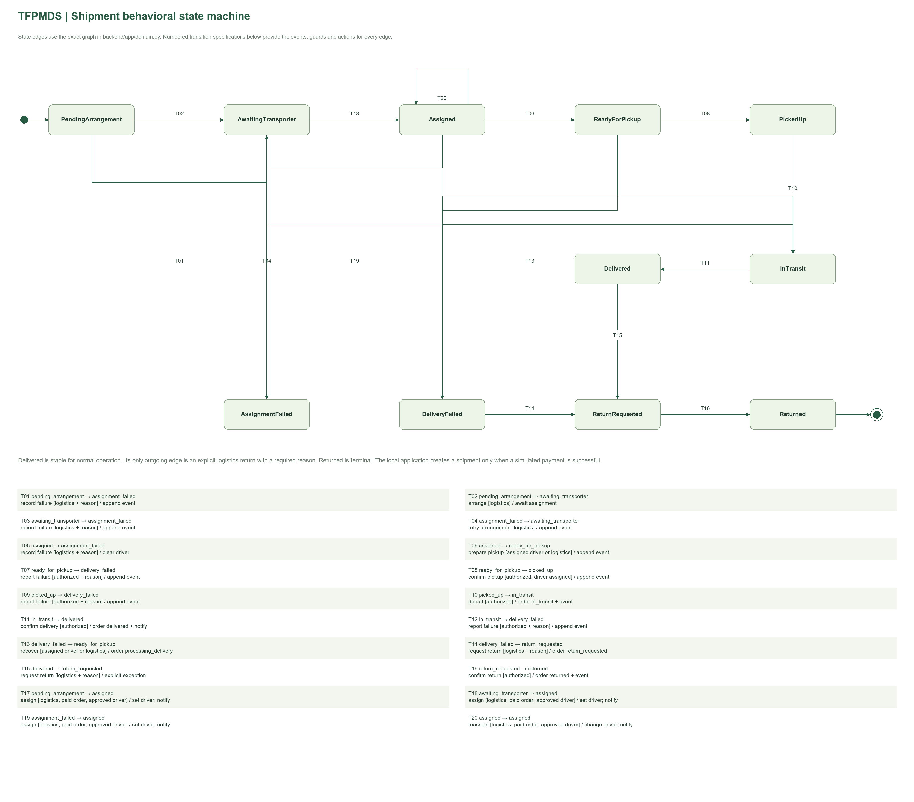

## 13. Overview package diagram

The overview separates Authentication, FarmerManagement, BuyerManagement, ProduceManagement, OrderManagement, PaymentManagement, LogisticsManagement, NotificationManagement, Administration, Reporting, Persistence and ExternalIntegrations. Each package is mapped to the actual modules that implement the responsibility. It is a conceptual responsibility view rather than a claim that every package is a separate Python directory.

Dependencies point toward shared guards, notifications, persistence and provider interfaces. Persistence does not depend on a business controller. The dependency catalogue is validated as a directed acyclic graph. This makes the intended direction reviewable even though several small responsibilities are implemented together in a feature module.

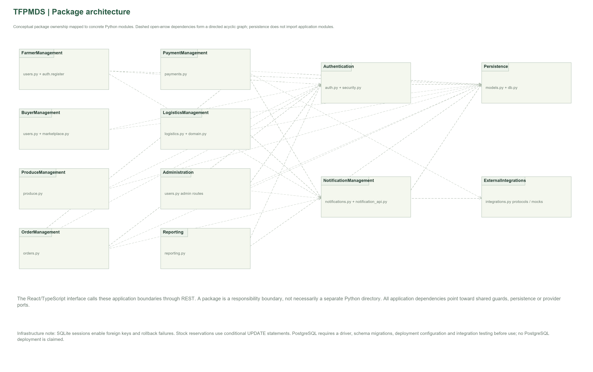

## 14. Detailed package diagrams

The identity/produce model includes User, Farmer, Buyer, Administrator, LogisticsOfficer, Transporter, Produce and MarketPrice. Role classes are explicitly marked as conceptual projections of the single User table. They are not invented ORM subclasses or extra account tables. Authentication and produce operations appear on the services that actually provide them.

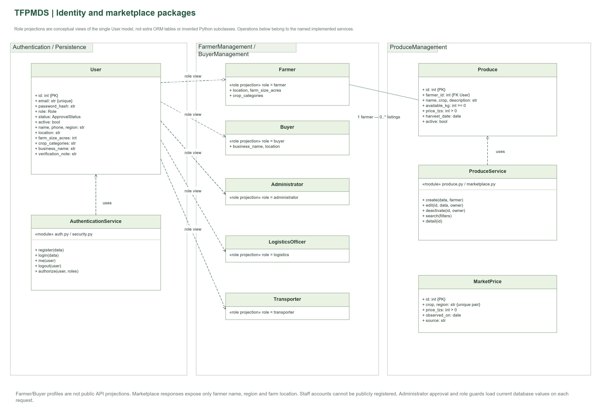

The ordering/payment model shows PurchaseOrder, OrderItem, Payment, PaymentReceipt, OrderService, PaymentService and MobileMoneyProvider. An order owns one or more line snapshots through ORM composition. An order has multiple possible payment attempts, but a successful order has at most one receipt and one shipment. The unique constraints and transition rules prevent duplicate successful outcomes.

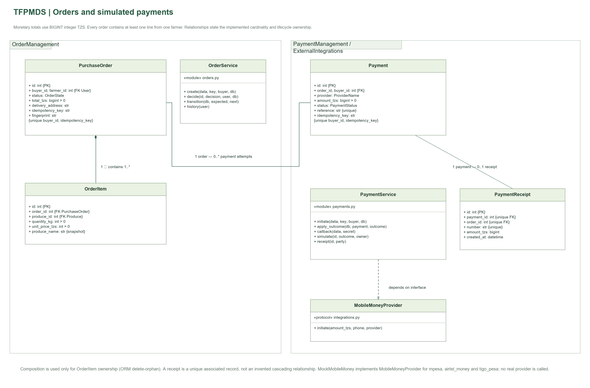

The logistics/notification model shows Shipment, TrackingEvent, Transporter, Notification, logistics/notification services and the SMS protocol/mock. Tracking events use composition because the ORM collection owns those records. Transporter assignment is an association; a transporter does not own or delete shipments. Receipt and account relationships are associations, so aggregation/composition is not used merely as decoration.

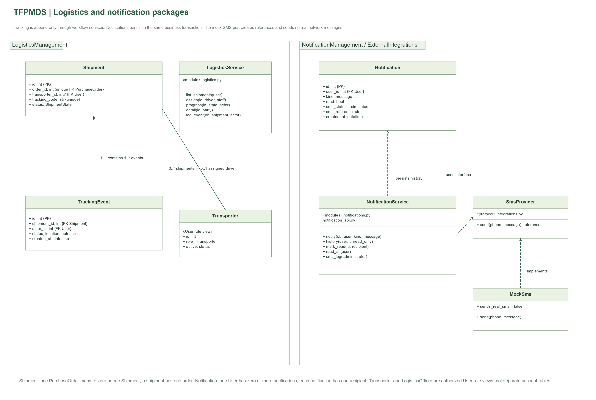

## 15. Database design

The relational schema contains 11 tables. Foreign keys are enabled explicitly for SQLite. IDs are stable integer primary keys; order and payment idempotency keys are scoped to the buyer. Monetary totals use BIGINT, while stock and unit prices are bounded integers. The complete generated DDL is retained in `database-schema.sql`.

| Table | Purpose and principal constraints |
| --- | --- |
| users | Unique email; permitted role/approval states; active flag; profile and verification data |
| revoked_tokens | JWT identifier primary key and expiry for server-side logout revocation |
| produce | Farmer FK; nonnegative unreserved stock; positive price; harvest date; active flag |
| purchase_orders | Buyer/farmer FKs; positive BIGINT total; allowed states; unique buyer/key pair; request fingerprint |
| order_items | Order/produce FKs; positive quantity/price; unique order/produce; produce-name and price snapshots |
| payments | Order/buyer FKs; allowed provider/outcome; positive BIGINT amount; unique reference and buyer/key pair |
| payment_receipts | Unique payment FK, order FK and receipt number; confirmed amount/time |
| shipments | Unique order FK and tracking code; nullable transporter FK; allowed workflow states |
| tracking_events | Shipment and actor FKs; status/location/note/time; chronological history |
| notifications | Recipient FK; kind/message/read flag; simulated SMS reference/status |
| market_prices | Unique crop/region; positive reference price; observation date and source |

Available stock excludes reserved quantities. Each order line uses a conditional SQL update that succeeds only if the listing is active and has sufficient quantity. If any line fails, the entire request rolls back, including earlier reservations. Order rejection/cancellation first claims a valid transition and then restores stock; repeated requests therefore cannot release it twice.

Payment completion similarly claims a pending attempt and a compatible order state. Success creates the receipt, shipment, initial tracking event and notifications together. Concurrent identical callbacks return the existing terminal result. Portable SQLAlchemy types and PostgreSQL DDL compilation support future migration planning, but schema migrations, driver configuration and PostgreSQL integration tests remain necessary.

## 16. API design

The API uses JSON request bodies, bearer authentication and routes under `/api`. Login accepts an email/password JSON object. Public registration permits only farmer or buyer. Staff are provisioned through the demo seed or an administrator-only endpoint. The current role, active flag and approval state are read from persistence for protected actions.

Core route families are `/auth`, `/users`, `/produce`, `/orders`, `/payments`, `/shipments`, `/notifications`, `/admin` and `/reports`. Interactive Swagger documentation is available at http://127.0.0.1:8010/docs; the generated `openapi.json` and `API_REFERENCE.md` describe all 34 API paths.

| Operation | Representative route | Important contract |
| --- | --- | --- |
| Register/login/logout | POST /api/auth/register, /login, /logout | Restricted registration roles; expiring/revocable bearer session |
| Approve account | POST /api/admin/users/{id}/approval | Administrator; decision and verification note |
| Manage listing | POST /api/produce; PATCH/DELETE /api/produce/{id} | Approved farmer owner; validated fields; deactivation preserves history |
| Search | GET /api/produce | Crop, region, price, quantity, text and farmer filters |
| Submit/decide order | POST /api/orders; POST /api/orders/{id}/decision | Idempotency key, one farmer, atomic stock and actor-specific decisions |
| Simulate payment | POST /api/payments; POST /api/payments/{id}/simulate | Accepted order; ordering buyer; no PIN; controlled outcomes |
| Callback/receipt | POST /api/payments/mock-callback; GET /api/payments/{id}/receipt | Secret-protected internal callback; party/staff-scoped receipt |
| Assign/progress | POST /api/shipments/{id}/assign, /status | Approved logistics/assigned transporter; explicit state graph |
| Reporting/history | GET /api/reports/summary; /api/admin/sms-log | Administrator; simulated gross totals and durable notification records |

Business errors return a stable code/message under `detail`. Validation uses Pydantic's field-error array. Status codes distinguish unauthenticated requests (401), forbidden actions (403), missing records (404), state/uniqueness conflicts (409) and invalid input (422). Database errors do not reveal SQL statements or credentials. The frontend presents readable errors and pending/success feedback.

## 17. User interface design

The interface uses agricultural green, soft neutral backgrounds, restrained crop illustrations, readable type, consistent cards and a shared sidebar. Navigation reflects the signed-in role. Pending/rejected accounts receive an explanatory banner. Forms use labels and validation, while tables preserve transaction details and provide horizontal scrolling inside their containers on smaller screens.

The 18 required screens are implemented: landing, both registration forms, login, farmer dashboard, produce management, marketplace, produce details, buyer order management, payment simulation, receipt, logistics dashboard, transporter dashboard, shipment tracking, administration, reference prices, reports and notifications. Profile editing and SMS history are additional views. Every displayed action is attached to a route, form submission, API operation, navigation, CSV download or browser print action.

Dashboard cards use API data rather than fabricated totals. Marketplace filters submit real query parameters. Order controls change with actor/state. Payment screens repeatedly identify the simulation and never ask for a PIN. Logistics forms use `next_states` from the backend, avoiding a second divergent transition graph in the client.

The following are genuine captures from the observed implementation, not mockups. The complete dashboard and selected workflow evidence are included at readable figure sizes; other captures are available in `screenshots/`.

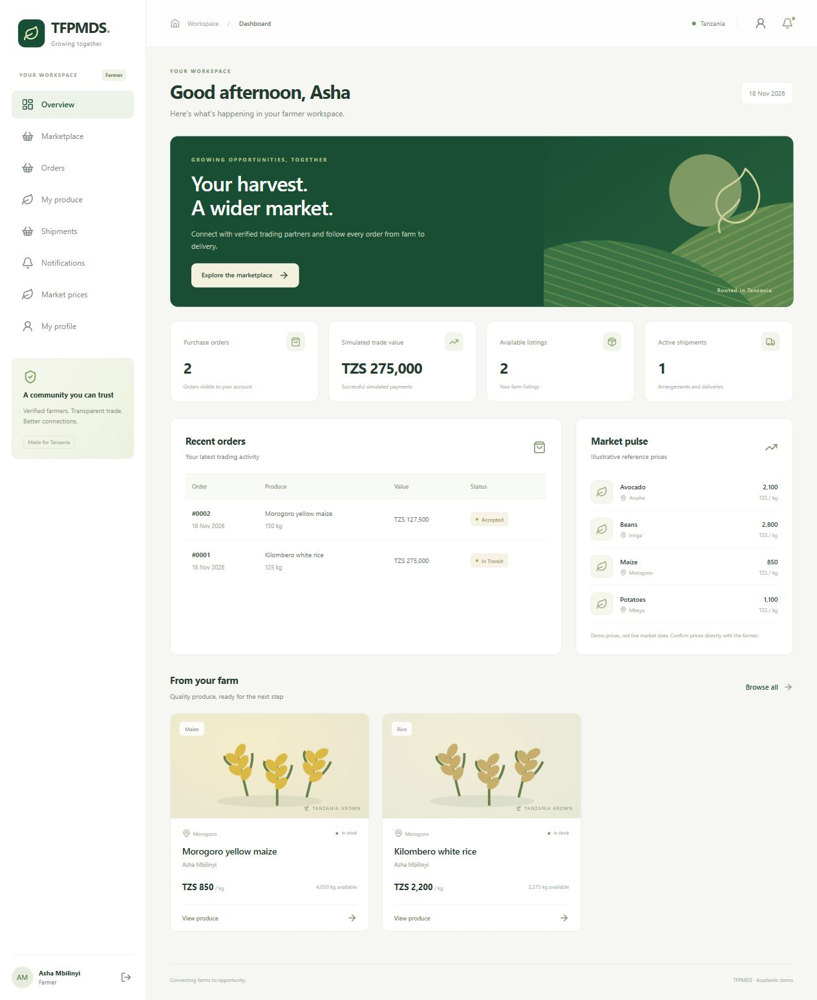

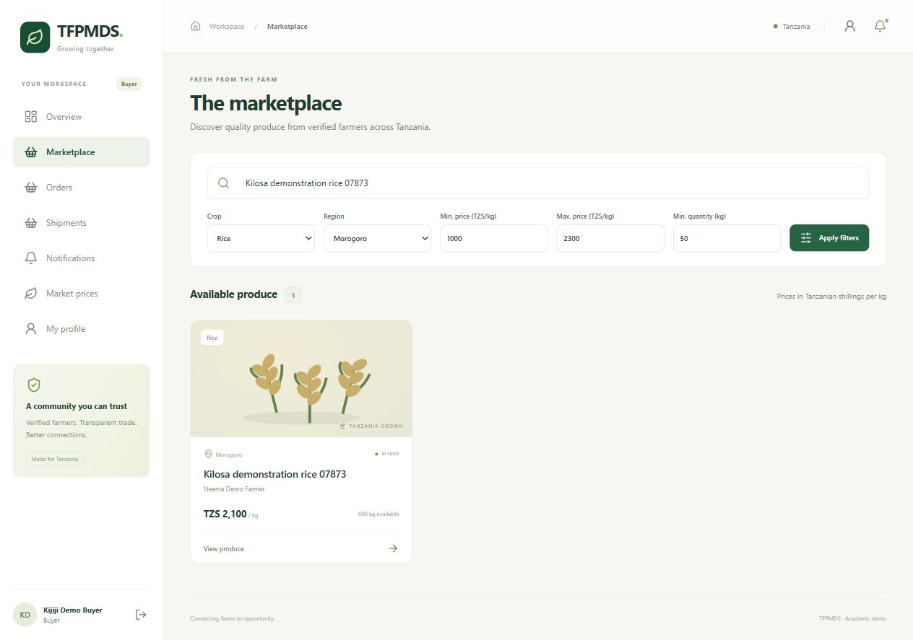

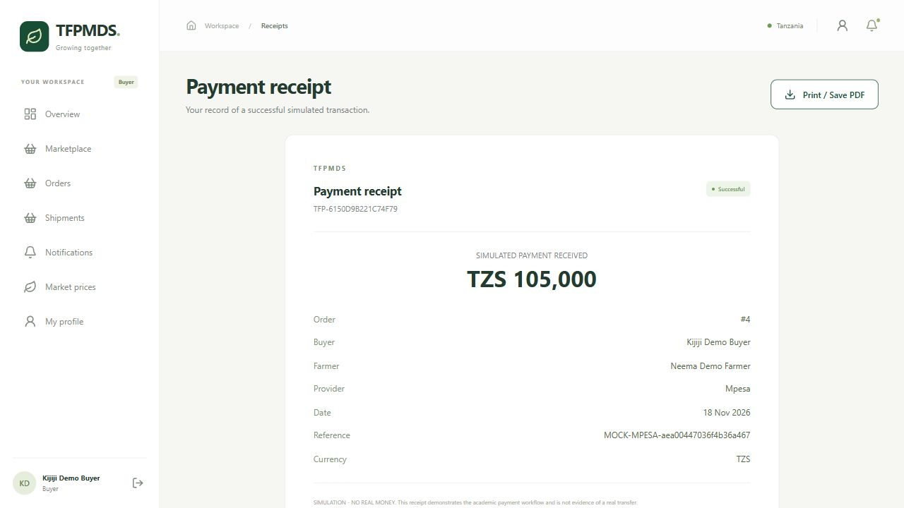

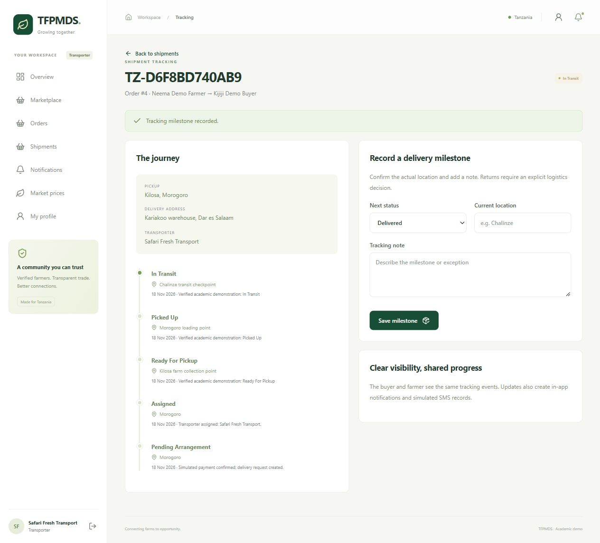

## 18. Prototype implementation

Backend feature modules cover authentication, users, produce, marketplace, orders, payments, logistics, notifications and reporting. Pydantic rejects extra privileged fields and invalid values. SQLAlchemy models provide relational constraints. Response projection helpers make public data exposure intentional. A common domain module defines allowed shipment transitions and persistent order states.

Frontend components share API error handling, session state, loading/empty feedback, status badges, cards and page headers. Authenticated data is scoped by the backend; hiding a button is not treated as authorization. JWTs are stored in the current tab's session storage, and successful logout revokes the server token identifier. Protected requests load the current account rather than trusting a role copied into an old token.

The seed contains 11 synthetic accounts across all five roles, eight produce listings and illustrative reference prices. Regions include Morogoro, Mbeya, Iringa, Mwanza and Arusha. Initial examples include rice, maize, potatoes, beans, tomatoes, avocados and sunflower. Three sample orders illustrate pending, accepted and in-transit work. Seed reruns preserve records rather than resetting a demonstration.

The fresh browser journey then registered two additional synthetic users and a new rice listing, completed a 50 kg order and confirmed delivery. Its recorded identifiers are in the demo guide. These observations demonstrate actual integration between frontend and backend, rather than inferring success from source code alone.

## 19. Agent-assisted development methodology

The human supplied the complete master brief, specified the official repository and later explicitly directed local-only development without granting access to the Codex-connected account. The human also confirmed the repository-local author identity `prettyglory <gloriambilinyi5@gmail.com>`. Those instructions controlled the work. No invented human prompts or contributor identities were introduced.

Codex inspected the empty repository and local tools, documented architecture/requirements, implemented coherent features and ran checks at milestone boundaries. Conventional commits record genuine setup, backend, frontend, UML, testing and documentation changes. The target contribution count was treated as a consequence of meaningful work rather than a quota to satisfy with empty or artificial commits.

`AGENT_DEVELOPMENT_LOG.md` separates human guidance from agent plans, actual changes, decisions, tests, errors, corrections and commit hashes. Hashes are appended after their commits and preserved in a later commit. A closing ledger records previous milestone hashes without attempting an impossible self-referential commit hash. The final closing commit is discoverable in Git history.

The methodology also records limitations honestly. Initial shell browser launches failed, a draft documentation patch was corrected, some selectors needed refinement and a tracking assertion ran before React navigation completed. None of these attempts was substituted for a verified outcome. The final browser evidence records the successful corrected journey. Codex did not push, add a collaborator, rewrite history or change the global Git identity. The project owner's subsequent human-authorized push published the original 26-commit baseline through `ddc2e8a`; the final academic corrections are additional local commits.

## 20. Testing strategy and results

The backend suite uses a temporary SQLite database with foreign keys enabled. It tests registration/login/logout, hashing, duplicate accounts, restricted roles, profile/approval changes, listing validation/ownership, search/privacy, orders, reservations, payment outcomes, receipts, notifications, delivery states and reports. A complete fresh-registration API journey connects the modules.

Concurrency tests use separate request sessions and competing threads. Two buyers attempt to reserve more combined stock than exists; exactly one succeeds and stock remains nonnegative. Two identical successful callbacks both return success while creating one receipt and one shipment. A multi-item failure rolls back prior reservations. Token expiry/revocation, inactive accounts and role mass assignment are also tested.

Vitest exercises actionable login failures, demo credential selection, filter submission, validation-error presentation and CSV escaping/formula neutralization. TypeScript compilation and Vite production build validate the integrated frontend. The supplied Playwright source mirrors the fresh-account workflow for a normal development machine. Because standard browser launch was blocked by the restricted shell, that runner is reported as typechecked rather than executed. The supported in-app browser independently completed the full UI journey with visible-state assertions and genuine screenshots.

| Check | Observed result |
| --- | --- |
| Pytest backend suite | 28 passed, 0 failed, 0 skipped |
| Vitest frontend suite | 5 passed, 0 failed, 0 skipped |
| TypeScript and Vite production build | Passed |
| Typed Playwright harness | Compilation passed; standard browser execution blocked before a test run |
| Supported in-app browser journey | All 14 steps passed; CSV download confirmed |
| Responsive marketplace/navigation | 390 x 844 viewport; no horizontal page overflow; navigation open/close passed |
| UML source/PNG checks | 8 valid editable documents and PNGs; 84 matching messages; required states/guards; acyclic package graph |
| Functional acceptance | 61/61 requirements supported, 100% in the simulated local scope |

Evidence is retained in JUnit XML, acceptance JSON, the browser journey JSON, screenshots and the development log. The Starlette TestClient emitted an upstream warning that httpx support is deprecated in favor of httpx2. All assertions passed; this dependency warning is disclosed rather than misreported as a test failure or silently hidden.

Coverage does not mean that every possible branch, browser, concurrent interleaving or deployment configuration has been tested. Production load, accessibility certification, external providers, recovery operations and PostgreSQL behavior remain unverified.

## 21. Implementation challenges

GitHub access initially prevented authenticated development under the original brief. The connected account had read-only repository permission, and local credentials were inaccessible to the session. The human resolved the constraint by authorizing local commits only. The implementation preserved the official remote and all genuine history. The project owner subsequently pushed the 26 original commits to the official main branch, ending at `ddc2e8a`. This correction pass preserves that published baseline and creates local commits for the owner's next push.

Stock and payment consistency required transactional design. Ordinary read-then-write stock arithmetic could oversell under concurrency. Conditional updates and rollback avoid that problem. Payment completion required a second conditional claim and unique receipt/shipment records so retries do not duplicate business effects.

Diagram readability was another challenge because one sequence covers 15 participants and four processes. The solution retains one canonical source diagram and derives process panels for the PDF. The same message catalogue generates the communication view. Manual visual inspection led to adjusted fragment separators, clearer relationship routing and explicit stable-versus-terminal state semantics.

The restricted shell blocked ordinary headless browser launches. The supported in-app browser provided an alternative for actual interaction and captures. Two selectors initially matched nested option text, and one count assertion ran before navigation rendered the tracking page. More precise control selection and waiting for the tracking heading resolved those verification issues. A local port conflict was handled by using 8010, without disturbing the unrelated service on 8000.

## 22. Security considerations

Passwords are hashed with Argon2 rather than encrypted reversibly or stored in plaintext. JWTs require the expected signing algorithm, issuer, audience, subject, unique identifier, issue time and expiry. Logout adds the token identifier to a revocation table. Protected requests also check that the account remains active, and writes require current approval/role/ownership.

Public registration cannot create staff or administrators. Profile validation forbids extra privileged fields. Users cannot edit another farmer's listing or decide another farmer's order. Buyers cannot pay another buyer's order, view unrelated receipts or alter shipment progress. Only approved logistics staff can assign transporters or authorize a return; only the assigned approved transporter or authorized staff can record ordinary progress.

Callbacks require a server-only mock secret. The frontend uses a separate buyer-owned simulation endpoint. Identical terminal replays are safe and conflicting outcomes fail. No real account, PIN, transfer or provider credential is involved. Public produce responses omit password hashes, email addresses and unnecessary profile details. CSV cells are quoted and formula-leading characters are neutralized.

The application is intentionally bound to loopback for demonstration. Before wider use it needs HTTPS, managed secrets, rate limiting, stronger operational audit and recovery controls, account recovery and external integration review. Session storage still requires protection against cross-site scripting; React escaping is helpful but not a complete production security assurance. This project did not perform or claim a full penetration test.

## 23. Future improvements

Near-term improvements are schema migrations, PostgreSQL integration tests, a deliberate deployment configuration and routine backup/restore checks. Production provider work should implement signed provider events, real reconciliation, an outbox and retryable delivery workers. SMS delivery status must then reflect actual provider acknowledgements rather than the current simulated label.

Business extensions include refund/reconciliation workflows, farmer identity-document review, richer transport capacity/route data, fractional quantities or standardized packaging, more detailed market-price sourcing, Swahili localization, accessibility evaluation and mobile/offline support. Each extension should preserve the existing authorization and transactional invariants.

Field testing with farmers, buyers and logistics teams should precede claims of real economic benefit. Such work could evaluate registration usability, trust in approval, stock accuracy, time to acceptance, payment reconciliation and delivery visibility. These are proposed evaluation activities, not results obtained by this prototype.

## 24. Conclusion

TFPMDS demonstrates a coherent local marketplace from fresh registration to buyer-confirmed delivery. Approved accounts, stock reservation, farmer acceptance, simulated payment, unique receipts, authorized assignment and shared tracking are implemented together. Administration and notification history make the same workflow inspectable.

The implementation meets the academic functional acceptance target with 61 mapped requirements, 33 passing automated tests, eight editable UML models and a verified browser journey. The source, evidence, documentation and local Git history remain available for review. Its limits are explicit: simulated integrations and local verification support an academic demonstration, while production operation requires further engineering and field validation.

## 25. References

1. Project owner (2026). TFPMDS master development brief and subsequent local-commit instructions. User-supplied assignment requirements and human guidance.
2. FastAPI. [OAuth2 with Password and JWT tokens](https://fastapi.tiangolo.com/tutorial/security/oauth2-jwt/). Consulted for authentication patterns.
3. SQLAlchemy. [Session basics](https://docs.sqlalchemy.org/en/20/orm/session_basics.html) and [SQLite dialect/transaction considerations](https://docs.sqlalchemy.org/en/20/dialects/sqlite.html). Consulted for persistence and transaction design.
4. Pydantic. [Models](https://docs.pydantic.dev/latest/concepts/models/). Consulted for typed validation and serialization.
5. React. [Quick start](https://react.dev/learn). Consulted for components, state and event handling.
6. Tailwind CSS. [Installing Tailwind with Vite](https://tailwindcss.com/docs/installation/using-vite). Consulted for local CSS integration.
7. Object Management Group. [Unified Modeling Language 2.5.1](https://www.omg.org/spec/UML/2.5.1). Reference for UML interaction, state and structural notation.
8. draw.io. [Manually edit diagram XML](https://www.drawio.com/docs/manual/advanced/diagram-source-edit/). Reference for editable mxGraph diagram source.

Online references were checked on 18 November 2026. The project does not derive unverified agricultural statistics or real market prices from these software references.

## 26. Installation and demonstration appendix

The repository README contains exact Windows installation commands and the optional Playwright/document-generation steps. Start the backend on 127.0.0.1:8010 and the frontend on the Vite URL, normally 127.0.0.1:5173. Seed explicitly with `python -m app.seed --demo` from the backend directory. All five primary role accounts use `DemoPass123!` and the aliases farmer, buyer, admin, logistics and transporter at `tfpmds.demo`.

Follow `DEMO_GUIDE.md` for the 14-step sequence and negative cases. The seed is repeatable without deleting work. The working SQLite database and development secrets are ignored by Git. The source schema/seed remain versioned. An optional synthetic SQLite snapshot in `demo/` preserves the observed completed browser journey using the final schema; it contains no JWT secret and excludes session revocations. The original 26 commits have already been pushed by the project owner. To publish the additional academic corrections, the owner can authenticate as gloria-mbilinyi, inspect the local history, fetch the official remote and run `git push -u origin main`. Codex has not pushed these corrections.

## 27. Appendices and traceability matrix

Appendix A below is generated from the same acceptance mapping as `REQUIREMENTS_TRACEABILITY.md`. Each row identifies implementation, passing test evidence and the selected detailed UML model. All rows also map to the comprehensive sequence and communication diagrams. Long tables use A4 landscape pages with repeated headers so source identifiers remain readable. All report pages now use A4 dimensions. The three editable Word parts follow original PDF content boundaries of pages 1-10, 11-20 and 21-45; their new pagination differs because the body text and diagrams are larger.

<!-- INCLUDE_TRACEABILITY -->

Appendix B consists of the versioned machine-readable API contract (`openapi.json`), generated relational DDL (`database-schema.sql`), JUnit reports, browser observations and diagram catalogues. Appendix C is the agent development log and local commit ledger. These files are part of the repository and accompany this PDF; the PDF does not invent additional test output or commit hashes.
